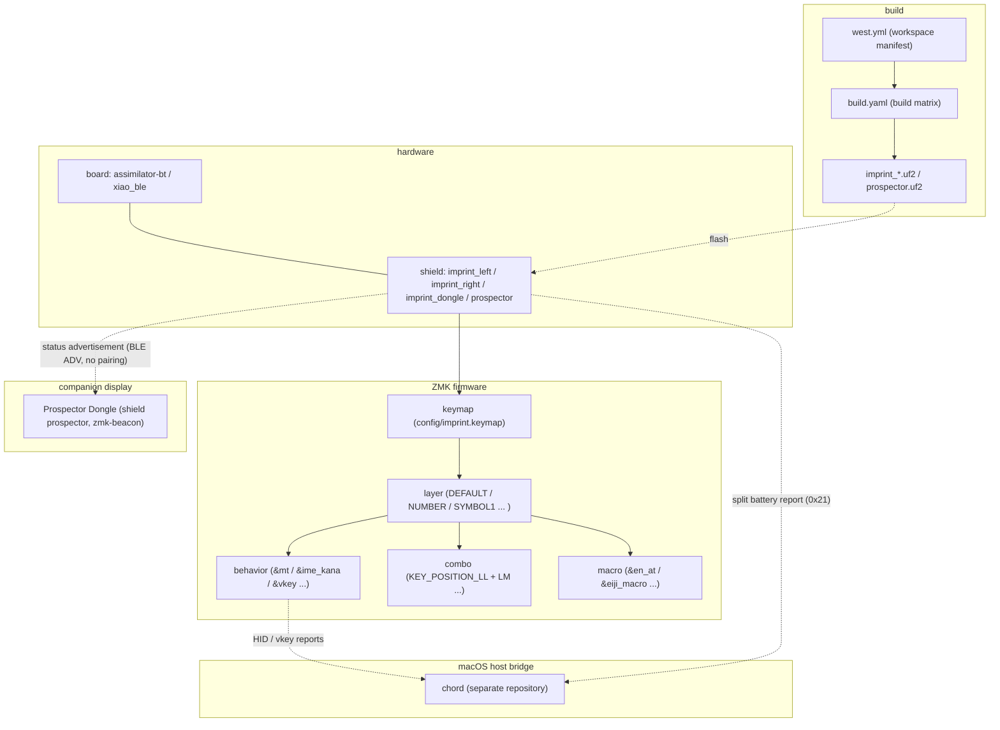

# canon ubiquitous language — Glossary

The canonical name of each part of canon. Code, docs, commit messages, PR
titles and prompts to Claude Code use only the names here: a synonym is drift.
Adding or renaming a term follows the rules at the end.

> Entry format: the canonical name, a definition of 1–2 sentences, where it
> lives in config or code, and a `Don't call it:` line listing the names the
> entry replaces.

---

## Overview

Where each term lives: the hardware, the ZMK firmware, the build, the macOS
host bridge and the companion display.

---

## Devices

### Cyboard Imprint
The split keyboard: the left and right halves (board `assimilator-bt`, shields
`imprint_left` / `imprint_right`), both BLE split peripherals of the
[[Imprint Dongle]] ([product page](https://cyboard.digital/products/imprint)).
On USB each half is one CDC ACM port (the left with product string `Imprint`,
the right with none; `scripts/dongle.py` tells them by their [[firmware stamp]]),
and 1200 baud on it reboots the half into its UF2 bootloader (Adafruit 0.9.2,
volume `ASSIMILATOR`) for `scripts/flash-dongle.sh` (images after canon#263 of
2026-10-19; both halves on hardware the same day).
- Config: [`config/imprint_left.conf`](../config/imprint_left.conf), [`config/imprint_right.conf`](../config/imprint_right.conf), [`config/cdc_acm_port.dtsi`](../config/cdc_acm_port.dtsi)
- **Don't call it:** the keyboard, Cyboard (that is the vendor), imprint alone (that is the `build-zmk.sh` group), キーボード本体

### Imprint Dongle
The split central: a XIAO nRF52840 (board `xiao_ble/nrf52840/zmk`) with shield
`imprint_dongle`, bonded to both halves over BLE and attached to the Mac as a
USB HID keyboard. Its USB product string `Imprint Dongle` is a contract with the
[[host bridge]] and, for a device or image without a [[firmware stamp]],
`scripts/dongle.py` ([CLAUDE.md](../CLAUDE.md)), and it
broadcasts the [[status advertisement]] that the [[Prospector Dongle]] shows.
- Config: [`config/imprint_dongle.conf`](../config/imprint_dongle.conf), [`config/imprint_dongle.overlay`](../config/imprint_dongle.overlay)
- **Don't call it:** XIAO, XIAO ドングル (both dongles are XIAO nRF52840s), Canon Dongle, receiver, central alone (that is the ZMK role)

### Prospector Dongle
The companion status display: a beekeeb pre-soldered
[Prospector](https://shop.beekeeb.com/products/pre-soldered-prospector-zmk-dongle)
(XIAO nRF52840 and a Waveshare 1.69" LCD; no ambient light sensor, touch panel
unwired) running shield `prospector` of the own module
[zmk-beacon](https://github.com/akira-toriyama/zmk-beacon). It shows both
halves' battery from the [[Imprint Dongle]]'s [[status advertisement]], which
it scans for passively, under a [[sprite]]; it advertises connectably only so
that the [[sprite sender]] can write a [[sprite pack]] into its [[sprite room]], and never
pairs, so it does not replace the Imprint Dongle.
- USB: one CDC ACM port with product string `Prospector Dongle`, no HID. Setting the port to 1200 baud reboots it into the UF2 bootloader, which `scripts/flash-dongle.sh` uses (both seen on hardware 2026-09-26); 2400 baud sends a [[screen dump]].
- The screen turns off after five minutes without a key press on the [[Cyboard Imprint]] and lights at the next one (zmk-beacon's `CONFIG_BEACON_SCREEN_OFF_AFTER_S`, default 300; the cycle seen on hardware 2026-10-04 with a 20 s setting): a dark screen is not a dead device.
- Config: [`config/prospector.conf`](../config/prospector.conf) (canon's additions only); the shield's defaults live in zmk-beacon, pinned by commit in [`config/west.yml`](../config/west.yml)
- **Don't call it:** XIAO, XIAO ドングル, Canon Dongle, scanner alone, Prospector alone in prose (the vendor's product; `prospector` is the shield), beacon (the module's name), second dongle, 表示ドングル

---

## Firmware terms

### keymap
The DeviceTree document that gives every key on every [[layer]] its
[[behavior]]: [`config/imprint.keymap`](../config/imprint.keymap), canon's one
keymap, which `#include`s `config/behavior_macros.h` and the keymap-side
[[dtsi]] files.
- **Don't call it:** layout, keyboard config, profile, レイアウト, 設定

### layer
One layer of the [[keymap]], switched on and off in ZMK's layer stack. A layer
has three names: its node name, its canonical name and its `display-name`.
- Defined in [`config/layers.h`](../config/layers.h) (the index, in the keymap's order) and [`config/imprint.keymap`](../config/imprint.keymap) (the keys)
- Node name: the index macro in `config/layers.h`. `config/arrow_behaviors.dtsi`, `config/macros.dtsi`, `config/behavior_macros.h` and the `layers` pairs of the [[behavior]] node `layer` in `config/imprint_behaviors.dtsi` use the same macros, so do not rename them.
- Canonical name: the name in prose and commits, words separated by spaces (`Symbol 1`, `Left Arrow`, `Vkey LL`), no hyphens or brackets.
- `display-name`: the short name in the firmware, shown in the [[keymap-drawer]] SVG and carried by the [[status advertisement]]. It matches `[A-Za-z][A-Za-z0-9]{0,3}` and is unique:
  - 4 ASCII characters at most: the status advertisement carries only the first 4 bytes, 0-padded (zmk-beacon `src/status_payload.h`; the Prospector Dongle does not show the name).
  - Unique: keymap-drawer keys layers by name, so a repeated name silently drops a layer, and with exit 0 `fail_on_error` does not catch it. Measured 2026-09-26 with keymap-drawer 0.23.0: one arrow sub-layer named `Fn` left 12 layers, Function's keys gone and stderr empty.
  - A letter, then letters and digits: keymap-drawer makes the SVG anchor id by turning spaces into `-` and dropping every character before the first ASCII letter or outside `[A-Za-z0-9-_:.]`, so `Fn!`, `Fn?` and `1Fn` all become `Fn`, while such a name is its own id.
  - Sources read 2026-09-26: keymap-drawer 0.23.0 `keymap_drawer/parse/zmk.py:211` and `keymap_drawer/draw/utils.py:26-35`.
- Node name → canonical name → `display-name`. The four arrow sub-layers are named after the arrow key that enters them, never after the keys they send; the Vkey layers are thumb layers that hold only [[vkey]]s.
  - `DEFAULT_LAYER` → Base → `Base`
  - `NUMBER_LAYER` → Number → `Num`
  - `SYMBOL1_LAYER` → Symbol 1 → `Sym1`
  - `SYMBOL2_LAYER` → Symbol 2 → `Sym2`
  - `FUNCTION_LAYER` → Function → `Fn`
  - `LEFT_ARROW_LAYER` → Left Arrow → `LArr`
  - `RIGHT_ARROW_LAYER` → Right Arrow → `RArr`
  - `UP_ARROW_LAYER` → Up Arrow → `UArr`
  - `DOWN_ARROW_LAYER` → Down Arrow → `DArr`
  - `T_LL_LAYER` → Vkey LL → `LL`
  - `T_LM_LAYER` → Vkey LM → `LM`
  - `T_RM_LAYER` → Vkey RM → `RM`
  - `T_RR_LAYER` → Vkey RR → `RR`
- **Don't call it:** mode, page, view, モード, ページ

### behavior
The ZMK building block for what a key does, referenced by an `&`-prefixed name
(`&kp`, `&mt`, `&mo`, `&ime_kana`, `&vkey`).
- canon's own: [`config/imprint_behaviors.dtsi`](../config/imprint_behaviors.dtsi), which includes [`config/letter_morphs.dtsi`](../config/letter_morphs.dtsi) and [`config/arrow_behaviors.dtsi`](../config/arrow_behaviors.dtsi), and the [[macro]]s of [`config/macros.dtsi`](../config/macros.dtsi); most are generated by the `#define`s in [`config/behavior_macros.h`](../config/behavior_macros.h) (`HOLD_TAP_HP200`, `ARROW_BEHAVIOR`, `LETTER_MORPH`, `EN_MACRO`, `TU_MOD`)
- **Don't call it:** action, binding, key handler, アクション, バインド

### combo
Keys pressed together that ZMK reads as one input. canon has two, each on the
lower thumb keys of one hand: `combo_kana` (LL + LM) and `combo_eiji`
(RM + RR).
- A tap switches the input source (KANA / EIJI) and a hold holds Shift+Cmd / Ctrl+Alt, through the `&ime_kana` / `&ime_eiji` [[hold-tap]]s.
- Defined in [`config/combos.dtsi`](../config/combos.dtsi)
- **Don't call it:** chord (that is the macOS host bridge), multi-key, simultaneous press, 同時押し, コード

### macro
A ZMK [[behavior]] that sends key presses and releases in order. canon's: the
`en_*` macros of the [[EIJI layer]], `eiji_macro` (the Shift side of the `al_*`
letter keys), `kana` / `eiji` (the taps of `&ime_kana` / `&ime_eiji`) and
`t_ll_ctrl` / `t_lm_alt` (upper thumb keys that hold a layer and a modifier).
- Defined in [`config/macros.dtsi`](../config/macros.dtsi)
- **Don't call it:** script, sequence, multi-tap, シーケンス

### EIJI layer
The `en_*` [[macro]]s, not a ZMK [[layer]]: each taps EIJI (`LANGUAGE_2`,
macOS's English input source key) and then holds a digit or symbol until the
key is released, so the character comes out as ASCII in any input mode.
- Single source: [`config/eiji_macros.dtsi`](../config/eiji_macros.dtsi). `scripts/gen-eiji-drawer-map.py` writes the AUTO-GENERATED block of `keymap_drawer.config.yaml` from it, and `verify-eiji-sync.yml` checks the block in CI: never edit between the markers.
- **Don't call it:** ascii layer, romaji layer, 英字レイヤー (fine as a figure of speech in prose)

### hold-tap
A [[behavior]] type that gives one key one meaning on tap and another on hold.
canon's: `&mt` (the lower thumb keys), `&ime_kana` / `&ime_eiji` (the
[[combo]]s; hold-preferred, 200 ms) and the arrow keys' `ar_*_ht`.
- `&mt` and the arrow hold-taps set `hold-while-undecided` ([zmkfirmware/zmk#1811](https://github.com/zmkfirmware/zmk/pull/1811)).
- Defined in [`config/behavior_macros.h`](../config/behavior_macros.h) (`HOLD_TAP_HP200`, `ARROW_BEHAVIOR`); the `&mt` setting is in [`config/imprint.keymap`](../config/imprint.keymap)
- **Don't call it:** dual function, dual-role, タップホールド

### vkey
An original key that collides with no other key input: the [[behavior]]
`&vkey <id>` sends the id in a vendor-defined HID report (usage page `0xFF31`,
Report ID `0x20`; the [[split battery report]]'s `0x21` shares the collection),
the id on press and 0 on release. The [[host bridge]] chord reads it with
IOHIDManager and maps the id to one of its actions.
- The [[keymap]]'s `&vkey` node is in [`config/imprint_behaviors.dtsi`](../config/imprint_behaviors.dtsi).
- Single source: the `&vkey <id>` keys of [`config/imprint.keymap`](../config/imprint.keymap). [`scripts/gen-vkey-aliases.py`](../scripts/gen-vkey-aliases.py) generates [`config/vkey-aliases.toml`](../config/vkey-aliases.toml) for chord from them, and `verify-vkey-sync.yml` checks it in CI. Ids: `0x01` and one 30-id block per Vkey layer (`0x10`–`0x2D`, `0x30`–`0x4D`, `0x50`–`0x6D`, `0x70`–`0x8D`), and `decode()` refuses any other id; `0xA0`–`0xBF` is reserved for the ist dongle of another repository, since chord maps ids in one namespace per host.
- Implementation: [`patches/zmk/vkey-report.patch`](../patches/zmk/vkey-report.patch), USB only. The patch, its upstream PR and the vkey design notes: [`patches/zmk/README.md`](../patches/zmk/README.md)
- **Don't call it:** custom keycode, vendor key, raw HID key, オリジナルキー (fine as a figure of speech in prose)

### split battery report
The vendor-defined HID input report in which the [[Imprint Dongle]] sends each
half's battery level to the host: usage page `0xFF31`, Report ID `0x21`,
2 bytes `{source, level}`, USB only (BLE HOG descoped, as for [[vkey]]).
- `source`: the split peripheral's slot index, 0 or 1, which a half keeps through reboots, reconnects and its own erase (derived from source), until the Imprint Dongle's NVS reset (how a half gets its slot and which half holds which: [docs/recovery.md](recovery.md#slot-order)).
- `level`: 0..100 percent. The `0` that ZMK raises when a half disconnects passes through unfiltered; the [[host bridge]] (chord), not the firmware, tells a disconnect from 0 %.
- Implementation: [`patches/zmk/vkey-report.patch`](../patches/zmk/vkey-report.patch), the same `0xFF31` collection and the same patch as [[vkey]] (why one patch: [`patches/zmk/README.md`](../patches/zmk/README.md)). Enabled by `CONFIG_ZMK_SPLIT_BLE_CENTRAL_BATTERY_LEVEL_{FETCHING,HID}=y` in [`config/imprint_dongle.conf`](../config/imprint_dongle.conf).
- Measuring: [CLAUDE.md](../CLAUDE.md), Debugging and device operations.
- **Don't call it:** BAS, battery service, battery notification, 電池通知, 残量通知, バッテリーレポート

### status advertisement
The BLE advertisement the [[Imprint Dongle]] broadcasts for the
[[Prospector Dongle]]: 26 bytes of manufacturer data (each half's battery
level, the highest active [[layer]]'s index and the first 4 bytes of its
`display-name`, a count of key presses, and the modifiers held, confirmed as
holds so that a [[hold-tap]] thumb's tap never counts) on a second, non-connectable
advertising set next to ZMK's own, every 200 ms; no pairing, no bond, no BLE
slot on either side. Both ends and the byte layout are zmk-beacon's
([`src/status_payload.h`](https://github.com/akira-toriyama/zmk-beacon/blob/main/src/status_payload.h)).
- Enabled by `CONFIG_BEACON_STATUS_BROADCAST=y` and `CONFIG_BT_EXT_ADV_MAX_ADV_SET=2` in [`config/imprint_dongle.conf`](../config/imprint_dongle.conf) (why the second line: the comment there); the halves' builds do not have it.
- **Don't call it:** status broadcast, beacon, telemetry, ステータス広告, 状態通知

### sprite
The animation the [[Prospector Dongle]] plays above the [[HP bar]]: a
[[sprite pack]], either the one last written into its [[sprite room]] over
BLE or one the build made from a GIF and embedded (zmk-beacon's
`CONFIG_BEACON_SPRITE_GIF`; size, tempo, key-press stepping and limits:
[zmk-beacon's README](https://github.com/akira-toriyama/zmk-beacon#the-sprite)).
A pack from the [[sprite sender]] holds a front and a back view: the back
plays while a modifier is held on the keyboard (the [[status advertisement]]
carries the modifiers), the front otherwise.
- The GIF is a personal file: embedded only by a local build, `./scripts/build-zmk.sh prospector --sprite <gif>` into `firmware/prospector-sprite.uf2`, never committed and never in CI or a release ([`assets/README.md`](../assets/README.md)); `prospector.uf2` embeds none and shows the room's.
- **Don't call it:** mascot, pet, avatar, character, GIF alone (that is the file), スプライト画像

### sprite pack
A [[sprite]]'s GIF repacked into the distinct pictures it shows and the order
it shows them in, each picture drawable on its own; file extension `.spk`,
magic `SPK1`, written by zmk-beacon's `tools/sprite_pack.py`: at build time
to embed, and by a sender to write into the [[sprite room]] over BLE (format
and why:
[zmk-beacon's docs/sprite-pack.md](https://github.com/akira-toriyama/zmk-beacon/blob/main/docs/sprite-pack.md)).
It carries the [[sprite name]].
- Made from the personal GIF, it stays out of commits, PRs and issues like the GIF.
- **Don't call it:** sprite sheet, pack alone, spk file, frame list, スプライトパック

### sprite room
The 384 KiB flash partition of the [[Prospector Dongle]] (zmk-beacon's shield
overlay, `sprite_partition`, 0x80000-0xdffff) that holds one [[sprite pack]]
written over BLE by the [[sprite sender]]; the device plays it at once and again after a
reboot or a reflash, and erases it for the next (zmk-beacon's
`CONFIG_BEACON_SPRITE_RECEIVE`, protocol in its `src/ble_receiver.c`). A
transfer that fails leaves the embedded sprite, or none, until the next one.
- **Don't call it:** slot, sprite partition in prose (that is the node), flash area, storage, 部屋 alone in English, スプライト領域

### sprite name
The text above the [[HP bar]], centred, carried by the [[sprite pack]] playing:
15 bytes of UTF-8 at most, all printable ASCII (unscii 16) or all katakana
(the [[katakana font]]): the [[name dictionary]]'s katakana name of the GIF's
place when the HP bar can show it (the user's rule, t-rq9h), else the GIF's
file name with the extension dropped, trimmed, the first letter upper-cased
and cut to 15 bytes, chosen so by the [[sprite sender]] for the pack it
writes into the [[sprite room]] and by
[`assets/sprite-name.py`](../assets/sprite-name.py) for a local sprite
build, which `build-zmk.sh --sprite` passes to zmk-beacon as
[`CONFIG_BEACON_SPRITE_NAME`](https://github.com/akira-toriyama/zmk-beacon/blob/main/Kconfig).
It names the GIF's subject, so it never appears in commits, PRs or docs; the
name row is empty until a pack plays.
- **Don't call it:** caption, label, title, character name, キャラ名, 名札

### katakana font
The bitmap font the [[Prospector Dongle]] draws a katakana [[sprite name]] in:
PKMN Strict from [nue-of-k/pkmn](https://github.com/nue-of-k/pkmn) (MIT), the
letters of the first Game Boy games at two pixels a dot and a pixel bolder,
rendered as whole blocks, never a name's subset, into zmk-beacon's
[`src/font_pkmn.c`](https://github.com/akira-toriyama/zmk-beacon/blob/main/src/font_pkmn.c)
by its `tools/pkmn_font.py`; an ASCII name keeps LVGL's unscii 16.
- **Don't call it:** Pokémon font, pokemon font, ポケモンフォント, kana font, pkmn font, PKMN Strict in prose, name font

### HP bar
The [[Prospector Dongle]]'s battery reading in a box along the bottom of the
screen: `HP` and a battle-screen style bar with its value on it (`65/100`),
the bar as long as the mean of both halves' levels, or the one half that has
a reading ([zmk-beacon's README](https://github.com/akira-toriyama/zmk-beacon#the-screen)).
In a [[sprite]] build the box has a first row with the [[sprite name]], centred
above `HP` and the bar (t-rq9h; a second row under them until 2026-10-26).
- **Don't call it:** battery bar, life bar, health bar, gauge, HP ゲージ, 体力バー

### screen dump
The [[Prospector Dongle]]'s screen, sent over its USB serial port when the host
sets the port to 2400 baud (zmk-beacon's `CONFIG_BEACON_SCREEN_DUMP`, on by
default in the `prospector` shield; record format:
[`src/screen_dump.c`](https://github.com/akira-toriyama/zmk-beacon/blob/main/src/screen_dump.c)).
`python3 scripts/dongle.py shot` turns it into a PNG and refuses an `--out`
path inside any git work tree.
- A [[sprite]] build's PNG shows the sprite and its [[sprite name]]: it never goes into a commit, a PR or an issue.
- **Don't call it:** screen capture, screenshot, framebuffer dump, snapshot (that is LVGL's `lv_snapshot`), 画面キャプチャ, スクショ

### own module
A Zephyr module of the user's own that [`config/west.yml`](../config/west.yml)
pins under its `akira-toriyama` remote by a full commit SHA, never a branch or
tag: zmk-beacon and [[zmk-lantern]] today. The scripts treat them alike
(`python3 scripts/stamp.py pins` lists them): the [[firmware stamp]] digests
each pin's tree id, every build checks each clone out at its pin, and
`./scripts/build-zmk.sh --module <dir>` builds a local tree in place of one (the
[[image]] carries `-beacon`, `-lantern`).
- A third needs no script change, only its project written like the two ([CLAUDE.md](../CLAUDE.md), Invariants).
- **Don't call it:** custom module, private module, third-party module (ZMK's and Cyboard's are upstream and not own), 自作モジュール

### zmk-lantern
The own ZMK module
([akira-toriyama/zmk-lantern](https://github.com/akira-toriyama/zmk-lantern))
that lights the [[Cyboard Imprint]]'s key LEDs only while USB powers a half
and the half is in use, and for the [[intro]] at boot: it drives the half's LED
rail (assimilator-bt P1.02, the pin ZMK's `ext_power` driver would own)
itself, on with a cable and off on battery or after five minutes without a key
(ZMK's idle state, `CONFIG_ZMK_IDLE_TIMEOUT`), so the LEDs cost the battery
nothing. Each half decides when to light from its own port and its own keys.
- Pinned by commit in [`config/west.yml`](../config/west.yml), like zmk-beacon. canon's side: [`config/lantern_rail.dtsi`](../config/lantern_rail.dtsi) (the disabled `EXT_POWER` node, the hog, the `lantern,rail` node), [`config/lantern_keys.dtsi`](../config/lantern_keys.dtsi) (the key LEDs' strip and the [[palette]] slot each key shows; each half's overlay adds the key under each LED in chain order and the strip's length) and the idle line of [`config/imprint_left.conf`](../config/imprint_left.conf) / [`config/imprint_right.conf`](../config/imprint_right.conf); the Imprint Dongle builds the module's [[palette]], pick, hit and layer sides (the behaviors, the port, the resend, the relay to the halves), the Prospector Dongle none of it.
- The product halves paint no picture (`CONFIG_LANTERN_NO_PICTURE`, t-skdt): the keys stay black while lit, each press, or a held [[layer]], draws the [[effect]] in the [[palette]]'s colours at full brightness under the frame's cap (`CONFIG_LANTERN_BRIGHTNESS`, 16 %, sets it), and the [[intro]] plays as the boot light; the [[countdown]] is off. ZMK's underglow is off on every target (`config/imprint.conf`). No `&rgb_ug` key ([CLAUDE.md](../CLAUDE.md), Invariants).
- **Don't call it:** backlight (ZMK's `backlight` is a different feature; fine as a figure of speech in prose), underglow alone (ZMK's feature; off on every target; the module paints the LEDs itself), lantern alone in prose, LED module, バックライトモジュール

### palette
The six colours (`0xRRGGBB`, slots 0..5) the Mac hands the [[Imprint Dongle]]
with `python3 scripts/dongle.py palette`, which the dongle and both halves of
the [[Cyboard Imprint]] keep in their settings across boots, and whose colours the [[effect]]s take: the [[crossing ring]] and the [[beams]] the pressed key's band, slots 0..4 in five bands left to right across both halves (the outer three columns of the left half, its inner three, both thumb clusters, the right half's inner three, its outer three: [`config/lantern_keys.dtsi`](../config/lantern_keys.dtsi)), the [[thin ring]] and the [[stain]] the next colour at each press, the [[disc]] all of them in turn, the [[water]] the first on a crest and the last in a trough, the ones between on the slopes, the [[dart]] all of them in slot order as it runs, the first at the pressed key, the [[layer keys]] the slot each layer is paired with; a black slot shows slot 0, and slot 5 is the spare. The dongle invokes the [[behavior]] node `palette` of
[`config/imprint_behaviors.dtsi`](../config/imprint_behaviors.dtsi), which
ZMK's split transport carries to both halves by its name, and resends the
palette after each battery report of a half, so a half that was away gets it
when it is back.
- The line on the dongle's USB serial port and its replies (`palette ok …`, `palette none`, `palette error: …`): zmk-lantern's [`src/port.c`](https://github.com/akira-toriyama/zmk-lantern/blob/main/src/port.c), which reads the [[effect]]'s line too; the storage, the behavior and the resend: its [`src/palette.c`](https://github.com/akira-toriyama/zmk-lantern/blob/main/src/palette.c).
- The daily palette (t-0967): the five colours the [[sprite sender]]'s `sprite-sender colours` prints for the GIF it last sent (zmk-beacon's `tools/sprite_colours.py`: the liveliest colour first), which the LaunchAgent in the user's dotfiles is to hand to `python3 scripts/dongle.py palette --wait 600` after each successful swap, so the key LEDs follow the [[Prospector Dongle]]'s [[sprite]]; a day whose swap failed sends no palette.
- The dongle's split run queue holds a whole palette and both picks, the [[effect]]'s and the [[intro]]'s, for both halves at once, three invocations a half for every palette set (two slots a call; the slots not sent are cleared to black, which the halves show as slot 0) and one for each pick: `CONFIG_ZMK_SPLIT_BLE_CENTRAL_SPLIT_RUN_QUEUE_SIZE=10` in [`config/imprint_dongle.conf`](../config/imprint_dongle.conf) ([CLAUDE.md](../CLAUDE.md), Invariants). A device flashed across the change from four slots to six ignores its stored palette: `palette none` until the next set.
- A palette taken from a [[sprite]] GIF is personal, like the GIF: its values go into no commit, PR, issue or doc, only the command's shape does.
- The [[countdown]] to the idle dark, when a trial image builds it, cycles through the palette's distinct colours, the whole half in one at a time, ten seconds each; the product images leave it off.
- **Don't call it:** colour scheme, theme, backlight colour (fine in prose for what the user sees), RGB setting, underglow colour (ZMK's state; the underglow is off), パレット設定

### countdown
What a half's key LEDs do between its last key and the idle dark: every ten
seconds a new picture, the bands, then the whole half in each colour of the
[[palette]] in turn, then the bands again, until the five minutes of
`CONFIG_ZMK_IDLE_TIMEOUT` turn the LEDs off; a key brings the bands back
([[zmk-lantern]]'s `CONFIG_LANTERN_COUNTDOWN` and `CONFIG_LANTERN_COUNTDOWN_STAGE_MS`,
on by default at 10000, its [`src/keys.c`](https://github.com/akira-toriyama/zmk-lantern/blob/main/src/keys.c); t-gsm2, t-x82q).
- Each half counts its own keys, while dark too (a trackball input moves ZMK's idle, not the pictures; a cable plugged in lights the picture the keys say). Colours that paint alike at the LEDs' brightness count once, so a day of three colours cycles through four pictures; one colour is the bands until the dark. In canon#272 (2026-10-20) a stage was a minute, the five minutes over the colour count, and the last colour held until the dark; the user chose the ten-second cycle on hardware the same day.
- Off in the product images since t-5hqx (`CONFIG_LANTERN_COUNTDOWN=n` in the halves' confs): with no picture the stages would only paint the whole half in a colour; a trial image (`--kconfig CONFIG_LANTERN_COUNTDOWN=y`) brings it back.
- **Don't call it:** fade, dimming, idle animation, timeout display, 段階表示, 消灯カウントダウン

### effect
The moving picture a key press draws on the [[Cyboard Imprint]]'s key LEDs, or
the still one of a held [[layer]] (the [[layer keys]]), and the pick of which
draws. Eight are built into the halves' images ([[thin ring]], [[disc]],
[[stain]], [[crossing ring]], [[beams]], [[water]], [[dart]], [[layer keys]];
`config/imprint_left.conf`), and `python3 scripts/dongle.py effect <name>
[RRGGBB]` (`thin-ring`, `disc`, `stain`, `cross-ring`, `beams`, `water`,
`dart`, `layer-keys`, then one colour at most) hands the [[Imprint Dongle]] the
pick, and its colour when one is given, which it keeps in its settings and
carries to both halves through the [[behavior]] node `effect` of
[`config/imprint_behaviors.dtsi`](../config/imprint_behaviors.dtsi), as the
[[palette]], and resends with it after each battery report of a half; `effect`
alone asks (`effect …`, the colour last when one is set, `effect none`).
- The default (t-5hqx): until the Mac's first pick, and whenever the stored pick names none of the built eight, a half draws the [[crossing ring]] (`CONFIG_LANTERN_EFFECT_DEFAULT_CROSS_RING`).
- The colour (t-rgp5): with one, every picked effect draws in that one colour, the [[stain]]'s dye too, in place of its colour source in the [[palette]] (that entry lists each effect's); a pick without a colour returns to the palette's. The dongle and the halves keep it with the pick (after the mask under `lantern/effect/mask`, one value; the behavior's second parameter, 0xRRGGBB, 0 for the palette's), and a change of the colour clears a half's running effects as a change of the pick does. Without a host zmk-lantern lets a split central's keymap bind `&effect <mask> <colour>` or its node `effect_next`, the next effect in turn (its README); canon's keymap binds neither, the Mac picks, and neither is verified on hardware. The colour on hardware 2026-10-27 (the stain red, then the palette's colours again; a stored pick survived the flash from the image before the colour).
- The names and the bit each carries: [[zmk-lantern]]'s table `LANTERN_EFFECT_LIST` ([`src/effect.h`](https://github.com/akira-toriyama/zmk-lantern/blob/main/src/effect.h); bit 7 is no effect's, so `layer-keys` is bit 8), and the names alone, in its order, `EFFECTS` in [`scripts/dongle.py`](../scripts/dongle.py); a new effect lands in both, with the conf line that builds it and an entry here, in one PR. Two or more names draw together (allowed, unused; t-gwsw decides the layering).
- The line on the dongle's port and its replies (`effect ok …`, `effect …`, `effect none`, `effect error: …`): zmk-lantern's [`src/port.c`](https://github.com/akira-toriyama/zmk-lantern/blob/main/src/port.c); the storage, the behavior and the resend: its [`src/effect.c`](https://github.com/akira-toriyama/zmk-lantern/blob/main/src/effect.c); the drawing: its `src/keys.c`.
- The daily effect (t-2d9r): the LaunchAgent in dotfiles is to pick one a day, as it hands the daily [[palette]].
- **Don't call it:** animation, lighting mode, RGB effect, underglow effect (ZMK's underglow is off on every target), 光り方, エフェクト設定

### thin ring
The [[effect]] `thin-ring`: from each pressed key a ring one key wide spreads
at twelve key units a second and fades out within a second, each press in the
[[palette]]'s next colour ([[zmk-lantern]]'s `CONFIG_LANTERN_THIN_RING`, its
`src/effects/thin_ring.c`; t-6ttk, OK on hardware 2026-10-21).
- With the hit (the [[crossing ring]]'s relay) a press of the other half rings in too, in across the split.
- **Don't call it:** ripple (zmk-rgb-matrix's name for the idea; fine in prose about that project), wave, ring alone where the [[crossing ring]] could be meant

### disc
The [[effect]] `disc`: from each pressed key a rim spreads at twelve key units
a second; a key it has passed lights at full brightness and fades back to
black over half a second, its colour running once through the [[palette]]'s
colours, so the disc is brightest at its rim and the day's colours pass
inside it (`CONFIG_LANTERN_DISC`; t-6ttk, OK on hardware 2026-10-21).
- **Don't call it:** splash (QMK's name for the idea), filled ring, circle

### stain
The [[effect]] `stain`: the [[thin ring]] that dyes the keys it passes within
about 4.8 key units of the press, each in the ring's colour at the picture's
brightness, so the half is painted over in the day's colours as you type,
until the LEDs go dark or the pick changes (`CONFIG_LANTERN_STAIN`, which
builds the thin ring too; t-6ttk, OK on hardware 2026-10-21).
- **Don't call it:** paint, dyeing ring (the dye is what the stain leaves), 染め in English text

### crossing ring
The [[effect]] `cross-ring`, the default: a thin ring from each pressed key
across the whole board, both halves, at twelve key units a second and without
fading until it has left the board, in the colour of the pressed key's band
([`config/lantern_keys.dtsi`](../config/lantern_keys.dtsi) `slots`), so both
halves draw one press in one colour (`CONFIG_LANTERN_CROSS_RING`; t-6ttk, OK on
hardware 2026-10-26).
- The hit: the [[Imprint Dongle]] relays each half's key presses to the other half through the [[behavior]] node `hit` of [`config/imprint_behaviors.dtsi`](../config/imprint_behaviors.dtsi) ([[zmk-lantern]]'s `src/hit.c`), only to a half whose link runs at peripheral latency 0, which a half asks for while USB powers it (its `src/latency.c`): a half on battery is dark and gets nothing.
- **Don't call it:** split ring, cross ring in prose (the Kconfig is `CROSS_RING` and the port's word `cross-ring`), 半分をまたぐ輪 in English text

### beams
The [[effect]] `beams`: from each pressed key four beams run outward along its
row and its column at twelve key units a second, four fifths of a key wide and
fading out over a second, in the colour of the pressed key's band
([`config/lantern_keys.dtsi`](../config/lantern_keys.dtsi) `slots`) as the
[[crossing ring]]; with the hit a press of the other half sends its row's beam
in across the split (`CONFIG_LANTERN_BEAMS`; t-6ttk, OK on hardware
2026-10-26).
- A key is on the row or the column within half a key unit, so each thumb cluster makes rows and columns of its own, and the two clusters share their rows: a thumb's beam runs into the other cluster.
- **Don't call it:** cross (QMK's name; the [[crossing ring]] is `cross-ring`), nexus, rays, lines, 十字 in English text

### water
The [[effect]] `water`: from each pressed key waves spread, a front at twelve
key units a second with a wavelength of three keys behind it, fading out over
a second and a half and weaker the farther from the key, and the waves of
every press add up, two crests rising higher and a crest meeting a trough
staying still; a key is pulled along the [[palette]] by the surface's height,
a full crest to the first colour, a full trough to the last, a lower wave to
the colours between, and as far as the surface is from still, so the black
keys stay black until a wave passes and the pressed key's first waves flicker
between the first and last colours four times a second (`CONFIG_LANTERN_WATER`;
t-6ttk, OK on hardware 2026-10-27).
- With the hit the other half's presses start waves too, low: about a fifth of a crest from an inner column, three fifths from a thumb.
- The research's wavelength of two keys stood still on the Imprint's grid of keys a unit apart (every key in step, the sign swapping key to key); three keys a wave show the travel (zmk-lantern#18's review).
- **Don't call it:** ripple (the [[thin ring]]'s idea), waves, water surface, 水面 in English text

### dart
The [[effect]] `dart`: from each pressed key a bar runs across the rows
toward the far half of the board at sixteen key units a second (a key of
the left half sends it right, one of the right half left), full at its
head and gone four fifths of a key from it, full on the pressed key's row
and two fifths as strong on the other rows, fading out over 1.2 s; its
colour is the [[palette]]'s first at the pressed key and slides along the
colours as it runs, the last a board's width on, so the bar changes colour
on its way (`CONFIG_LANTERN_DART`; t-6ttk, OK on hardware 2026-10-27).
- With the hit the bar runs on into the other half: a press of an inner column comes in across the split at about two thirds of its strength, a thumb's nearly full; the other half shows most of a bar from an inner key.
- The last colour shows only from a bar that started at an outer column: from an inner column it leaves the board three quarters of the way along the palette (zmk-lantern's review, 2026-10-27).
- **Don't call it:** sweep (the research's early name), comet, streak, runner, 打鍵で走る光 in English text

### layer keys
The [[effect]] `layer-keys`: while a [[layer]] is held, the keys it gives a
meaning of its own (neither `&none` nor `&trans` nor the same [[behavior]] and
parameters as Base at that key) light in the [[palette]] slot it is paired
with, and a key press draws nothing; the [[Imprint Dongle]], where the
[[keymap]] runs, sends the halves those keys through the behavior node `layer`
of [`config/imprint_behaviors.dtsi`](../config/imprint_behaviors.dtsi), whose
`layers` pairs name the layers shown and their slots ([[zmk-lantern]]'s
`CONFIG_LANTERN_LAYER_KEYS` on the halves, its `src/effects/layer_keys.c`, and
`CONFIG_LANTERN_LAYER`, on by the node, its `src/layer.c`; t-6ttk, OK on
hardware 2026-10-28).
- canon's pairs (t-6ttk's research, 5-6): Number slot 0, Symbol 1 slot 1, Symbol 2 slot 3 (the same keys as Symbol 1, told apart by colour), Function slot 4, Vkey LL and LM slot 1, Vkey RM and RR slot 3; the four arrow layers are left out, as an arrow key's hold-tap raises its layer for a mere tap. The highest held layer the pairs name shows.
- A layer shows 60 ms after it becomes the highest held layer the pairs name, so a short tap does not flash, and goes as soon as no named layer is held. Number, Symbol 1, Symbol 2 and Function light keys of the right half only (10, 16, 16 and 12), each Vkey layer 15 on each half; a held Ctrl or Alt thumb (`TU_LL`, `TU_LM`) lights its Vkey layer too.
- Only a lit half shows it: the dongle sends to a half at peripheral latency 0, as the hit (the [[crossing ring]]), and a half dark for idle shows it from its own next key. Nothing is stored: a half drops the keys when its link or its USB power goes.
- A pick's colour paints every layer in it, so Symbol 1 and Symbol 2 then look alike; under the frame's cap a layer of many keys or a whitish colour shows dimmer than one of few.
- **Don't call it:** layer indicator, layer lights, layer highlight, active keys, 使える鍵だけ光る in English text

### intro
What a half's key LEDs play as the boot light, at boot and whenever a cable is
plugged in, for the intro's own length, and the pick of which plays (t-qvgv).
Two are built into the halves' images (`config/imprint_left.conf`): the bands,
a second of the [[palette]]'s bands (`CONFIG_LANTERN_INTRO_BANDS`; the pick's
`bands`), and the [[star waves]] (`CONFIG_LANTERN_INTRO_STAR_WAVES`; the pick's
`star-waves`).
- The pick: `python3 scripts/dongle.py intro <name>` hands the [[Imprint Dongle]] the pick, one name, which it keeps in its settings and carries to both halves through the [[behavior]] node `intro` of [`config/imprint_behaviors.dtsi`](../config/imprint_behaviors.dtsi), as the [[effect]]'s pick, and resends with the palette after each battery report of a half; `intro` alone asks (`intro …`, `intro none`).
- The default: until the Mac's first pick, and whenever the stored pick names an intro not built, a half plays the star waves (`CONFIG_LANTERN_INTRO_DEFAULT_STAR_WAVES`).
- A key pressed while an intro plays draws no effect; nothing cuts it short.
- The names and the bit each carries: [[zmk-lantern]]'s table `LANTERN_INTRO_LIST` ([`src/intro.h`](https://github.com/akira-toriyama/zmk-lantern/blob/main/src/intro.h)) and `INTROS` in [`scripts/dongle.py`](../scripts/dongle.py); a new intro lands in both, with the conf line that builds it and an entry here, in one PR. One intro a pick (two names: `intro error: one intro at a time`).
- The line on the dongle's port and its replies (`intro ok …`, `intro …`, `intro none`, `intro error: …`): zmk-lantern's [`src/port.c`](https://github.com/akira-toriyama/zmk-lantern/blob/main/src/port.c); the storage, the behavior and the resend: its [`src/intro.c`](https://github.com/akira-toriyama/zmk-lantern/blob/main/src/intro.c) on the shared [`src/pick.c`](https://github.com/akira-toriyama/zmk-lantern/blob/main/src/pick.c); the playing: its `src/keys.c`, one file an intro under its `src/intros/`.
- **Don't call it:** boot animation, splash screen, boot light (the module's name for the window the intro fills; not the show), opening (the task's working name), オープニング in English text

### star waves
The [[intro]] `star-waves`: the ten-second show in red, blue and green only, one
colour a key at a time and never white (t-ky8x, 2026-10-27): a star crossing
the half from the outer keys to the thumbs, waves and rings in and back out, the
three colours flowing outward as crests, and a star running back out (the flow
and the star out, t-x46t, 2026-10-27), the user's pick after Pokemon's first
games ([[zmk-lantern]]'s `CONFIG_LANTERN_INTRO_STAR_WAVES`, its
`src/intros/star_waves.c`; t-5v1f, 2026-10-22). The intro the halves play until
the Mac's first pick.
- **Don't call it:** the intro (one of two now), star-wave, 星, スターウェーブ in English text

---

## Hardware and build terms

### board
The MCU's circuit board as ZMK and Zephyr define it; a [[build target]] pairs
one with a [[shield]]. canon has two: `assimilator-bt` (the [[Cyboard Imprint]]'s
halves, from Cyboard's `zmk-keyboards` on its `zephyr-4.1` branch) and
`xiao_ble/nrf52840/zmk` (`imprint_dongle` and `prospector`).
- `assimilator-bt` is a hardware-model-v2 board, which is why ZMK follows `main` rather than a tag and `zmk-keyboards` follows `zephyr-4.1` rather than `main`: the comments in [`config/west.yml`](../config/west.yml)
- Config: [`config/west.yml`](../config/west.yml), [`build.yaml`](../build.yaml)
- **Don't call it:** controller, mcu board, mcu pcb (only for the physical PCB; in a build context say `board`)

### shield
What ZMK builds on top of a [[board]]: the device's matrix, physical layout and
peripherals. canon's four: `imprint_left` / `imprint_right` (the halves),
`imprint_dongle` (the [[Imprint Dongle]]) and `prospector` (the
[[Prospector Dongle]]).
- Config: [`build.yaml`](../build.yaml), the single source of board × shield
- Origin: the three imprint shields come from the Cyboard module (`zmk-keyboards`, `zephyr-4.1` branch), `prospector` from the own module zmk-beacon (pinned by commit). canon has no local shield: `imprint_dongle` went upstream with [Cyboard-DigitalTailor/zmk-keyboards#19](https://github.com/Cyboard-DigitalTailor/zmk-keyboards/pull/19) on 2026-07-28 and the local copy was removed.
- **Don't call it:** half, side, panel, 分割キーボード

### west
The Zephyr / ZMK workspace tool. canon's manifest is
[`config/west.yml`](../config/west.yml), not a file at the repository root.
- **Don't call it:** package manager, dependency manager, パッケージマネージャ

### build target
One `board × shield` pair. canon has four, the "all" build:
`assimilator-bt × imprint_left` / `imprint_right` and
`xiao_ble/nrf52840/zmk × imprint_dongle` / `prospector`. `build-zmk.sh` takes
a subset by shield name or group (`imprint`: the three imprint shields;
`prospector` alone).
- Config: [`build.yaml`](../build.yaml)
- **Don't call it:** firmware variant, build config, ビルド構成

### image
A built firmware file, `firmware/<shield>.uf2` (`imprint_left.uf2`,
`imprint_right.uf2`, `imprint_dongle.uf2`, `prospector.uf2`), which flashes a
device when copied onto its UF2 bootloader volume; `firmware/` is git-ignored.
Option builds add a suffix to the name (`prospector-sprite.uf2`,
`imprint_dongle-logging.uf2`; the scheme is in the header of
`scripts/build-zmk.sh`).
- Built by `./scripts/build-zmk.sh` (Docker, workspace `~/.cache/zmk-canon`); CI builds the same four, and the release draft attaches them.
- The build runs in a container of the Docker image `zmkfirmware/zmk-build-arm` (`ZMK_IMAGE`): call it the Docker image, never "image" alone.
- **Don't call it:** binary, uf2 artifact (an artifact is the zip a CI run uploads), ファーム本体

### firmware stamp
The USB manufacturer string of every [[image]], `ZMK Project (canon <shield>
<12 hex><variant>)`: a digest of the files this repository feeds that
[[build target]]'s build (the table and the rule: the header of
`scripts/stamp.py`), set by `scripts/zmk-west.sh build` and read back from a
device by `python3 scripts/dongle.py check`, which tells whether the firmware on
USB is what `origin/main` builds.
- `<variant>` is the image name's suffix without its leading `-sprite` (`-logging`, `-beacon` or `-lantern` for a `--module` tree, `_RESET`, `-<tag>`); a plain or sprite build has none.
- The stamp changes with the inputs, not with the commit: a comment-only change to `config/` keeps it, a pin bump or a patch edit moves every target's.
- An [[own module]]'s pin counts by the tree id of the pinned commit, so a re-pin to the same tree keeps every stamp.
- **Don't call it:** version string, build id, firmware version, manufacturer tag, 版の印

### dtsi
DeviceTree Source Include: a partial DeviceTree source that the [[keymap]] or a
[[build target]]'s `*.overlay` pulls in with `#include`. canon's are
`combos.dtsi`, `macros.dtsi`, `imprint_behaviors.dtsi`, `eiji_macros.dtsi`,
`arrow_behaviors.dtsi` and `letter_morphs.dtsi` on the keymap side, and
`lantern_rail.dtsi` in both halves' overlays.
- **Don't call it:** include file, dts fragment, ヘッダ

---

## Outside the firmware

### host bridge
The macOS program that acts on what the firmware sends:
[chord](https://github.com/akira-toriyama/chord), a separate repository (a
Swift 6 daemon on CGEventTap, driven by `~/.config/chord/config.toml`). It
reads the [[vkey]] and [[split battery report]]s from the [[Imprint Dongle]],
which it finds by USB product string; canon holds only the ZMK side.
- **Don't call it:** receiver, host side, ホスト側スクリプト

### sprite sender
The Mac program that writes a [[sprite pack]] into the [[Prospector Dongle]]'s
[[sprite room]] over BLE: zmk-beacon's
[`tools/sprite-sender`](https://github.com/akira-toriyama/zmk-beacon/tree/main/tools/sprite-sender)
(a Swift app, `SpriteSender.app`), which takes the next GIF of the collection on
the external drive, one a run, in the order and range its config sets
([zmk-beacon's README](https://github.com/akira-toriyama/zmk-beacon#the-sprite-sender)),
packs it with its back view, names it from the [[name dictionary]] when it can
and sends it; a LaunchAgent in the user's dotfiles
runs it once a day, and a failed day is skipped; its `colours` subcommand prints
the colours of the GIF it last sent, for the [[palette]]. Its config (`sender.json`) and
state live next to the collection ([`assets/README.md`](../assets/README.md)),
off every repository.
- **Don't call it:** BLESend, uploader, daily swap script, 送信スクリプト, 送信アプリ

### name dictionary
The JSON file next to the [[sprite sender]]'s config (`names` in `sender.json`,
`names.json` on the external drive) that gives a place of the order file a
katakana name: an array of `{"no", "ja", "en"}` objects, one a species in
National Pokédex order, written by zmk-beacon's
[`tools/name_dictionary.py`](https://github.com/akira-toriyama/zmk-beacon/blob/main/tools/name_dictionary.py)
from PokeAPI's species names and read by the sender's `NameDictionary` and by
[`assets/sprite-name.py`](../assets/sprite-name.py) for the [[sprite name]]. It
names the collection's subjects, so it lives off every repository.
- **Don't call it:** name table, 和名表, species list, lookup file, dictionary alone in prose, 辞書 alone in English text

### keymap-drawer
The external tool
([caksoylar/keymap-drawer](https://github.com/caksoylar/keymap-drawer)) that
draws the [[keymap]] as `keymap-drawer/imprint.svg` (with
`keymap-drawer/imprint.yaml`), configured by `keymap_drawer.config.yaml` at the
repository root. The Draw keymap workflow
([`.github/workflows/draw-keymap.yml`](../.github/workflows/draw-keymap.yml),
keymap-drawer 0.23.0) generates and commits `keymap-drawer/`: never edit it by
hand.
- **Don't call it:** keymap visualizer, layout renderer, ビジュアライザ

---

## Rules for entries

- One canonical name per concept. When several names circulate, pick the winner here and list the others on its `Don't call it:` line.
- A canonical name is spelled as in the code: ZMK identifiers keep their form (`&mt`, `&mo`, `DEFAULT_LAYER`, `imprint_left`).
- A definition is 1–2 sentences; link to the config or source for behavior instead of restating it.
- Where a term meets another repository ([chord](https://github.com/akira-toriyama/chord), [zmk-beacon](https://github.com/akira-toriyama/zmk-beacon), [zmk-lantern](https://github.com/akira-toriyama/zmk-lantern)), link to the meeting point.
- A new term goes into this file in the PR that introduces it; rename a term in code, docs and this file in the same PR.
- The glossary site builds from this file (`.github/workflows/glossary.yml` → akira-toriyama/glossary-site): one H1, H2 sections, H3 entries, wikilinks to H3 terms. Its renderer ends a list item at the line end, so a bullet stays on one line; it splits a `Don't call it:` line into aliases at every `,` and `、`, so a note inside an alias has no comma; and in an entry it reads a `#` after a space as a tag.
